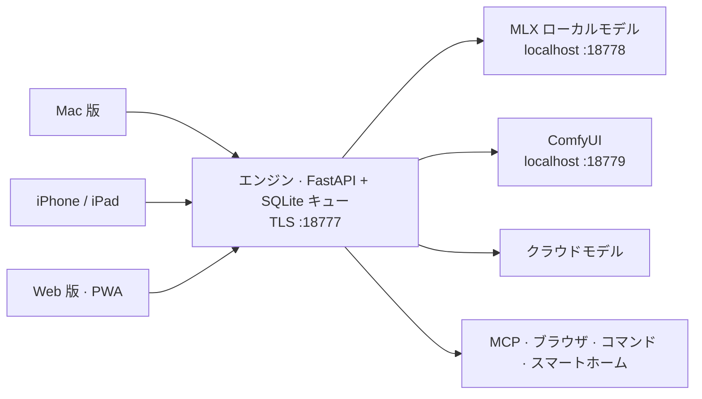

<p align="center"></p>

<h1 align="center">Jurvis</h1>

<p align="center">自分の Mac で動くパーソナルアシスタント。チャット、画像の読み取り、画像生成、動画、コード、スマートホームを一つの対話で。</p>

<p align="center">
  <a href="pyproject.toml"></a>
  <a href="docs/TESTING.md"></a>
  <a href="docs/TESTING.md"></a>
  <a href="LICENSE"></a>
  
  
</p>

<p align="center"><a href="README.md">English</a> · <a href="README.zh-CN.md">简体中文</a> · 日本語</p>

> [!NOTE]
> **0.1.0 は開発プレビューです。** 実際のモデルとメディアで検証済みですが、実機、長期安定性、リリース署名の検証はまだ完了していません。アプリの画面は現在中国語です。

## 機能

| | |
|---|---|
| **モデル** | 既定はローカルの視覚言語モデルで、完全にオフラインで動作します。[Miavo](https://miavo.xyz) のクラウドモデルや、OpenAI 互換のサービス（OpenAI、DeepSeek、OpenRouter、Ollama、LM Studio）も使えます。 |
| **エージェント** | 計画モード、目標モード（自律実行と独立したレビュー）、読み取り専用サブタスクの並列実行、Web 検索とページの読み取り。 |
| **記憶** | 長期的な事実をバックグラウンドで抽出。意味検索またはキーワード検索、シークレット対話、長い対話の要約。 |
| **スキルと MCP** | 標準の `SKILL.md` 形式で、`~/.claude/skills/` と共有できます。MCP サーバーはローカルプロセスと HTTP に対応。 |
| **コード** | 許可したプロジェクトを読んで検索し、変更を差分として提示します。適用と取り消しができ、pytest / Swift / npm スクリプトを実行できます。 |
| **コマンドとブラウザ** | Mac 上でコマンドを実行し、専用プロファイルのブラウザを操作します。操作ごとに確認します。 |
| **メディア** | 画像生成と参照画像の編集（Qwen Image）、最初と最後のフレームからの動画、ショートドラマの全工程、H.264/AAC 書き出し。 |
| **音声** | 音声入力、読み上げ、ハンズフリーの音声会話。認識と合成は Mac 上のローカルモデルで行い、クライアントは録音と再生だけを担当します。 |
| **スマートホーム** | Home Assistant、Philips Hue、SmartThings、Tuya など 16 種類のコネクタ。 |
| **電話** | ご自身の Twilio または Telnyx アカウントを使い、レストランなどのお店に代わりに電話して予約や問い合わせを行い、通話内容とともに結果を報告します。 |
| **クライアント** | Mac、iPhone、iPad（共通の SwiftUI コード）とインストール可能な Web 版。すべて同じエンジンにペアリングします。 |
| **タスク** | SQLite の永続キュー。キャンセル、再試行、冪等な投入に対応。ローカル GPU のジョブは一つずつ、クラウドの対話は並列で実行します。 |

## クイックスタート

**必要なもの：** Apple Silicon、Xcode、Python 3.12、[uv](https://docs.astral.sh/uv/)、ffmpeg。検証機は M5 Pro / 64GB です。

```bash
git clone https://github.com/SpectreMercury/Jurvis.git && cd Jurvis
./scripts/bootstrap.sh      # 固定した依存関係、ComfyUI、モデルのパス
./scripts/start-engine.sh   # エンジンは https://127.0.0.1:18777 で起動
```

次にクライアントを開きます。

| クライアント | 方法 |
|---|---|
| Web 版 | `https://127.0.0.1:18777/app/` を開き、自己署名証明書を許可します。 |
| Mac 版 | `./scripts/build-apps.sh` を実行し、`build/release/Build/Products/Release/Jurvis.app` を開きます。 |
| iPhone / iPad | Xcode で `JurvisMobile` をビルドし、**设置 → 配对 iPhone 或 iPad**（設定 → ペアリング）でペアリングします。 |

外出先で使う場合は、両方の端末に [Tailscale](https://tailscale.com) を入れます。ペアリング済みの端末は LAN と Tailscale を自動で切り替えます。

## アーキテクチャ



| パス | 内容 |
|---|---|
| `engine/` | API、タスクのスケジューリング、モデルのルーティング、記憶、スキル、MCP、ツール、コードワークベンチ、メディアワークフロー |
| `engine/home/` | スマートホームのコネクタ |
| `web/` | Web 版（PWA）。ビルド不要 |
| `native/Sources/` | 共通の SwiftUI 画面、TLS クライアント、キーチェーン、QR コードの読み取り |
| `config/` | 固定した依存バージョン、ランタイムの取得元、拡張のチェックサム |
| `data/` | 対話、素材、設定、秘密情報。ローカルのみで、リポジトリにはコミットしません。 |

## セキュリティ

- **直接接続。** 端末は TLS で Mac に直接接続します。証明書のピン留めと一回限りのペアリング招待を使い、クラウドの中継はありません。
- **既定はローカル。** ローカルモデルは何も外部に送信しません。クラウドモデルを選ぶと、対話、添付、取り出した記憶、ツールの結果がそのサービスに送信されます。
- **まず確認。** コマンドの実行、コードの変更、ブラウザのクリックと入力、読み取り専用でない MCP ツール、錠、ドア、カメラ、そしてすべての電話は、実行前に確認します。
- **サンドボックスなし。** コマンドとプロジェクトのスクリプトは、Mac 上であなたのユーザー権限で実行されます。アシスタントが自動でコミット、プッシュ、公開することはありません。

## テスト

```bash
./scripts/check.sh                              # 単体テスト、コンパイルと構文のチェック
.venv/bin/python -m pytest --cov=engine         # カバレッジ（pytest-cov が必要）
```

| スイート | 範囲 |
|---|---|
| `check.sh` | 単体テスト 167 件、`engine/` のステートメントカバレッジ 81% |
| `e2e.sh` | 実際のモデルで API の全工程：対話、画像の読み取り、画像生成、動画、ショートドラマ、コーディング、ペアリング |
| `scenarios.sh` | 26 本の複数ターンの対話を 1 ターンずつ検査 |
| `longtasks.sh` | モデルの 1 回の出力を超える長いタスクを、実測結果で判定 |
| `ui-smoke.sh` · `ui-typing.sh` · `ui-press.sh` | Mac 版の描画、入力、ボタンの挙動 |

実際のモデルを使うスイートは、実行ごとに結果がばらつきます。詳しくは[テスト](docs/TESTING.md)と[検証記録](docs/VALIDATION.md)をご覧ください。

## ドキュメント

| | |
|---|---|
| [エンジンのデプロイ](docs/DEPLOY.md) | インストール、起動、設定、ログイン時の自動起動、他の端末からのアクセス |
| [ローカルモデル](docs/MODELS.md) | 自分の MLX モデルの利用、Ollama / LM Studio の接続、クラウドサービス |
| [Web 版（PWA）](docs/PWA.md) | 開く、ペアリング、ホーム画面への追加 |
| [ネイティブアプリ](docs/APPS.md) | Mac 版のビルド、iPhone / iPad へのインストール、TestFlight |
| [スマートホームのコネクタ](docs/CONNECTORS.md) | 対応ブランドと、それぞれに必要なトークン |
| [電話](docs/PHONE.md) | 電話サービスの連携、通話の流れ、固定のルールと制限 |
| [クリエイティブ拡張](docs/EXTENSIONS.md) | 任意の動画コンポーネント、正確なバージョンとチェックサム |
| [データと運用](docs/OPERATIONS.md) | データの配置、ポート、バックアップ、安全上の境界 |
| [テスト](docs/TESTING.md) | 単体テスト、カバレッジ、受け入れスイート |

`docs/` 以下のドキュメントは現在中国語のみです。

## ライセンス

[Apache License 2.0](LICENSE)。モデルの重み、ComfyUI ノード、サードパーティのプロンプトガイドはソースと一緒に配布しておらず、それぞれのライセンスに従います。詳しくは[出典の記録](docs/SOURCES.md)をご覧ください。
