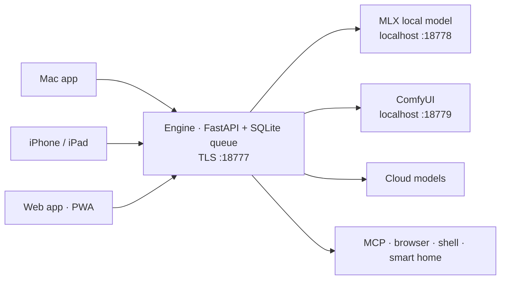

<p align="center"></p>

<h1 align="center">Jurvis</h1>

<p align="center">A personal assistant that runs on your Mac. One conversation for chat, vision, images, video, code and your home.</p>

<p align="center">
  <a href="pyproject.toml"></a>
  <a href="docs/TESTING.md"></a>
  <a href="docs/TESTING.md"></a>
  <a href="LICENSE"></a>
  
  
</p>

<p align="center">English · <a href="README.zh-CN.md">简体中文</a> · <a href="README.ja.md">日本語</a></p>

> [!NOTE]
> **0.1.0 is a developer preview.** It is validated with real models and real media, but not yet on physical iOS devices, for long-term stability, or with release signing. The app interface is currently in Chinese.

## Features

| | |
|---|---|
| **Models** | Local vision-language model by default, fully offline. Optional cloud models through [Miavo](https://miavo.xyz) or any OpenAI-compatible service (OpenAI, DeepSeek, OpenRouter, Ollama, LM Studio). |
| **Agent** | Plan mode, goal mode (autonomous, independently reviewed), parallel read-only subtasks, web search and page reading. |
| **Memory** | Long-term facts extracted in the background, semantic or keyword retrieval, incognito conversations, summaries for long threads. |
| **Skills & MCP** | Standard `SKILL.md` skills, shared with `~/.claude/skills/`. MCP servers over stdio or HTTP. |
| **Code** | Reads and searches an authorised project, proposes diffs you apply and can undo, runs pytest / Swift / npm scripts. |
| **Shell & browser** | Runs commands and drives a separate browser profile on the Mac, with per-action confirmation. |
| **Media** | Text-to-image and image editing (Qwen Image), first/last-frame video, full short-drama pipeline with H.264/AAC export. |
| **Smart home** | 16 connectors, including Home Assistant, Philips Hue, SmartThings and Tuya. |
| **Clients** | Mac, iPhone and iPad (one SwiftUI codebase) and an installable web app, all paired to the same engine. |
| **Tasks** | Persistent SQLite queue with cancel, retry and idempotent submission. Local GPU jobs run one at a time, cloud conversations in parallel. |

## Quick start

**Requirements:** Apple Silicon, Xcode, Python 3.12, [uv](https://docs.astral.sh/uv/) and ffmpeg. Validated on an M5 Pro with 64 GB.

```bash
git clone https://github.com/SpectreMercury/Jurvis.git && cd Jurvis
./scripts/bootstrap.sh      # locked dependencies, pinned ComfyUI, model paths
./scripts/start-engine.sh   # engine on https://127.0.0.1:18777
```

Then open a client:

| Client | How |
|---|---|
| Web app | Open `https://127.0.0.1:18777/app/` and accept the self-signed certificate. |
| Mac app | Run `./scripts/build-apps.sh`, then open `build/release/Build/Products/Release/Jurvis.app`. |
| iPhone / iPad | Build `JurvisMobile` in Xcode, then pair from **设置 → 配对 iPhone 或 iPad** (Settings → Pair). |

Away from home, install [Tailscale](https://tailscale.com) on both devices. Paired devices switch between LAN and Tailscale automatically.

## Architecture



| Path | Contents |
|---|---|
| `engine/` | API, task scheduling, model routing, memory, skills, MCP, tools, code workbench, media workflows |
| `engine/home/` | Smart-home connectors |
| `web/` | Web app (PWA), no build step |
| `native/Sources/` | Shared SwiftUI interface, TLS client, keychain, QR scanning |
| `config/` | Pinned dependency versions, runtime sources, extension checksums |
| `data/` | Conversations, assets, settings and secrets. Local only, never committed. |

## Security

- **Direct connection.** Devices talk to the Mac over TLS with certificate pinning and one-time pairing invitations. There is no cloud relay.
- **Local by default.** The local model sends nothing off the machine. A cloud model receives the conversation, attachments, retrieved memories and tool results.
- **Confirmation first.** Shell commands, code changes, browser clicks and typing, non-read-only MCP tools, and locks, doors and cameras all ask before acting.
- **No sandbox.** Commands and project scripts run as your user on the Mac. The assistant never commits, pushes or publishes on its own.

## Testing

```bash
./scripts/check.sh                              # unit tests, compile and syntax checks
.venv/bin/python -m pytest --cov=engine         # coverage (needs pytest-cov)
```

| Suite | Scope |
|---|---|
| `check.sh` | 167 unit tests, 81% statement coverage of `engine/` |
| `e2e.sh` | Full API flow with real models: chat, vision, images, video, short drama, coding, pairing |
| `scenarios.sh` | 26 multi-turn conversations checked turn by turn |
| `longtasks.sh` | Tasks longer than a single model output, judged by measured results |
| `ui-smoke.sh` · `ui-typing.sh` · `ui-press.sh` | Mac app rendering, input and button behaviour |

The real-model suites show some run-to-run variance. Details are in [Testing](docs/TESTING.md) and the [validation record](docs/VALIDATION.md).

## Documentation

| | |
|---|---|
| [Deploying the engine](docs/DEPLOY.md) | Install, start, configure, start at login, reach it from other devices |
| [Local models](docs/MODELS.md) | Use your own MLX model, connect Ollama / LM Studio, cloud providers |
| [Web app (PWA)](docs/PWA.md) | Open, pair, install to the home screen |
| [Native apps](docs/APPS.md) | Build the Mac app, install on iPhone / iPad, TestFlight |
| [Smart-home connectors](docs/CONNECTORS.md) | Supported brands and the token each one needs |
| [Creative extensions](docs/EXTENSIONS.md) | Optional video components, exact versions and checksums |
| [Data and operations](docs/OPERATIONS.md) | Data layout, ports, backup, safety boundaries |
| [Testing](docs/TESTING.md) | Unit tests, coverage and acceptance suites |

The documents under `docs/` are currently available in Chinese only.

## License

[Apache License 2.0](LICENSE). Model weights, ComfyUI nodes and third-party prompt guides are not distributed with the source and follow their own licenses. See the [source record](docs/SOURCES.md).
