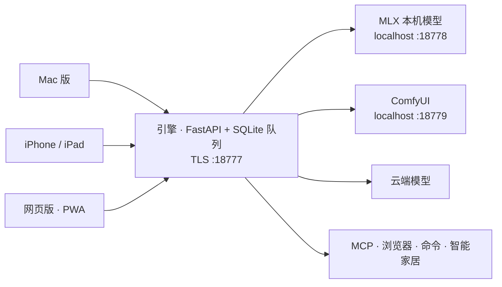

<p align="center"></p>

<h1 align="center">Jurvis</h1>

<p align="center">运行在你自己 Mac 上的个人助理。聊天、读图、生图、视频、改代码和控制家居，都在同一个对话里。</p>

<p align="center">
  <a href="pyproject.toml"></a>
  <a href="docs/TESTING.md"></a>
  <a href="docs/TESTING.md"></a>
  <a href="LICENSE"></a>
  
  
</p>

<p align="center"><a href="README.md">English</a> · 简体中文 · <a href="README.ja.md">日本語</a></p>

> [!NOTE]
> **0.1.0 是开发预览版。** 已有真实模型和媒体验证，尚未完成真机、长期稳定性和发布签名验收。

## 功能

| | |
|---|---|
| **模型** | 默认使用本机视觉语言模型，完全离线。可选 [Miavo](https://miavo.xyz) 云端模型，或任何 OpenAI 兼容服务（OpenAI、DeepSeek、OpenRouter、Ollama、LM Studio）。 |
| **Agent** | 计划模式、目标模式（自主执行并独立复核）、并行的只读子任务、联网搜索和网页读取。 |
| **记忆** | 后台提取长期事实，语义或关键词检索，无痕对话，长对话自动摘要。 |
| **技能与 MCP** | 通用的 `SKILL.md` 技能，与 `~/.claude/skills/` 共享。MCP 服务支持本地进程和 HTTP。 |
| **代码** | 阅读和搜索已授权的项目，修改以差异卡片呈现，可应用可撤销，可运行 pytest / Swift / npm 脚本。 |
| **命令与浏览器** | 在 Mac 上执行命令、操作独立用户目录的浏览器，每个动作先确认。 |
| **媒体** | 文生图和参考图编辑（Qwen Image）、首尾帧视频、完整短剧流程，H.264/AAC 导出。 |
| **语音** | 语音输入、朗读和免手动的语音对话。识别和合成都在 Mac 上用本地模型完成，客户端只负责录音和播放。 |
| **智能家居** | 16 个连接器，包括 Home Assistant、Philips Hue、SmartThings、涂鸦。 |
| **客户端** | Mac、iPhone、iPad（同一套 SwiftUI 代码）和可安装的网页版，配对到同一个引擎。 |
| **任务** | SQLite 持久化队列，支持取消、重试和幂等提交。本机显卡任务一次一个，云端对话并行。 |

## 快速开始

**要求：** Apple Silicon、Xcode、Python 3.12、[uv](https://docs.astral.sh/uv/)、ffmpeg。验证机器为 M5 Pro / 64GB。

```bash
git clone https://github.com/SpectreMercury/Jurvis.git && cd Jurvis
./scripts/bootstrap.sh      # 锁定的依赖、固定版本的 ComfyUI、模型路径
./scripts/start-engine.sh   # 引擎运行在 https://127.0.0.1:18777
```

然后打开一个客户端：

| 客户端 | 方式 |
|---|---|
| 网页版 | 打开 `https://127.0.0.1:18777/app/`，接受自签名证书。 |
| Mac 版 | 运行 `./scripts/build-apps.sh`，打开 `build/release/Build/Products/Release/Jurvis.app`。 |
| iPhone / iPad | 在 Xcode 构建 `JurvisMobile`，然后在 **设置 → 配对 iPhone 或 iPad** 配对。 |

在外面使用时，两端安装 [Tailscale](https://tailscale.com)。已配对的设备会在局域网和 Tailscale 之间自动切换。

## 架构



| 路径 | 内容 |
|---|---|
| `engine/` | API、任务调度、模型路由、记忆、技能、MCP、工具、代码工作台、媒体工作流 |
| `engine/home/` | 智能家居连接器 |
| `web/` | 网页版（PWA），不需要构建 |
| `native/Sources/` | 共享的 SwiftUI 界面、TLS 客户端、钥匙串和扫码 |
| `config/` | 固定的依赖版本、运行时来源、扩展校验清单 |
| `data/` | 对话、素材、设置和密钥。只在本机，不提交到仓库。 |

## 安全

- **直连。** 设备通过 TLS 直接连接 Mac，使用证书指纹固定和一次性配对邀请，没有云端中继。
- **默认本地。** 本机模型不向外发送任何内容。选择云端模型时，对话、附件、取回的记忆和工具结果会发送给所选服务。
- **先确认。** 执行命令、修改代码、浏览器点击和输入、非只读的 MCP 工具，以及门锁、门和摄像头，都先问你。
- **没有沙箱。** 命令和项目脚本以你的用户身份在 Mac 上运行。助手不会自动提交、推送或发布。

## 测试

```bash
./scripts/check.sh                              # 单元测试、编译和语法检查
.venv/bin/python -m pytest --cov=engine         # 覆盖率（需要 pytest-cov）
```

| 套件 | 范围 |
|---|---|
| `check.sh` | 167 项单元测试，`engine/` 语句覆盖率 81% |
| `e2e.sh` | 真实模型跑完整 API 流程：对话、读图、生图、视频、短剧、Coding、配对 |
| `scenarios.sh` | 26 段多轮对话，逐轮检查 |
| `longtasks.sh` | 超出单次模型输出的长任务，按实测结果判定 |
| `ui-smoke.sh` · `ui-typing.sh` · `ui-press.sh` | Mac 版的渲染、输入和按钮行为 |

真实模型的验收结果有波动。详见[测试与验收](docs/TESTING.md)和[验收记录](docs/VALIDATION.md)。

## 文档

| | |
|---|---|
| [部署引擎](docs/DEPLOY.md) | 安装、启动、配置、开机自启、从其他设备访问 |
| [本地模型](docs/MODELS.md) | 换用自己的 MLX 模型，接入 Ollama / LM Studio，云端服务 |
| [网页版（PWA）](docs/PWA.md) | 打开、配对、装到主屏幕 |
| [原生 App](docs/APPS.md) | 构建 Mac 版，装到 iPhone / iPad，TestFlight |
| [智能家居连接器](docs/CONNECTORS.md) | 支持的品牌和各自需要的令牌 |
| [创作扩展](docs/EXTENSIONS.md) | 可选的视频组件、准确版本和校验 |
| [数据与运维](docs/OPERATIONS.md) | 数据目录、端口、备份、安全边界 |
| [测试与验收](docs/TESTING.md) | 单元测试、覆盖率和验收脚本 |

## 许可证

[Apache License 2.0](LICENSE)。模型权重、ComfyUI 节点和第三方提示词规范不随源码分发，各自遵循其许可证，详见[来源记录](docs/SOURCES.md)。
